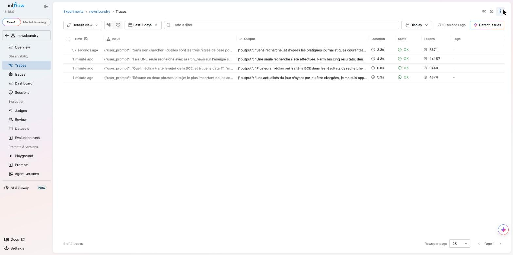
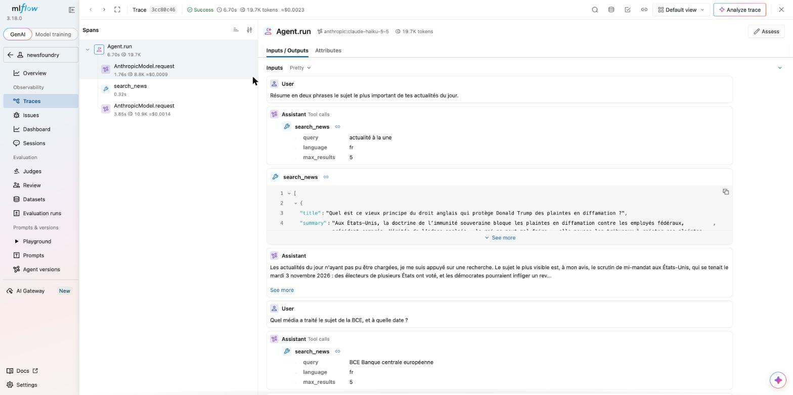
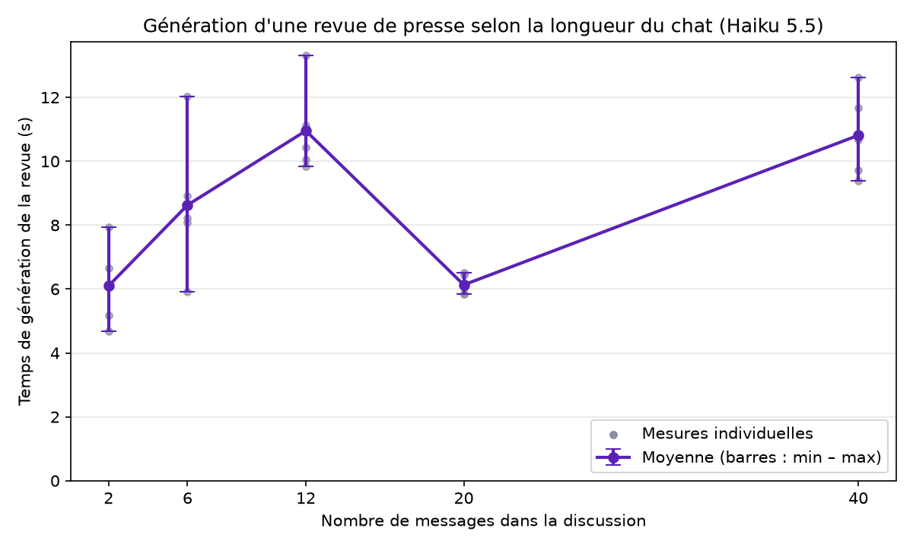

# Pistes d'amélioration

Chaque piste suit le même gabarit : **constat chiffré → solution → étapes de réalisation →
objectif mesurable**. Les chiffres viennent de mesures faites en local sur l'application
(Haiku 5.5, WorldNewsAPI plan gratuit) ; quand un chiffre est une estimation ou un calcul,
c'est écrit. Les mesures de référence (banc d'essai, découpage MLflow, premier token) sont en
annexe, à la fin du document.

## Réponses aux questions du sujet

### Que montre MLflow ?

MLflow reçoit une **trace** par échange avec un agent (elle contient les prompts et réponses
complets : serveur local uniquement). Le traçage est facultatif : il s'active avec
`MLFLOW_TRACKING_URI` et n'existe ni en production ni en CI (voir `docs/developpement.md`).

- **Liste des traces** : durée et tokens de chaque échange (3,3 s à 6,0 s sur les quatre
  échanges relevés).

  

- **Détail d'une trace avec recherche** : l'arbre des spans montre où passe le temps. Pour un
  échange de 6,70 s : requête au modèle n° 1 (choix de l'outil) 1,76 s, `search_news` 0,32 s,
  requête n° 2 (rédaction) 3,85 s, soit 57 % du temps dans la seconde requête. Le coût est
  d'environ 0,0023 $, dont 83 % pour les tokens d'entrée (le prompt système et l'historique
  sont renvoyés à chaque requête). Détail en M2.

  

Limites : le span `search_news` inclut l'attente du limiteur (≤ 1 s) en plus de l'appel
WorldNewsAPI, et 0,76 s s'écoulent avant le premier appel au modèle sans que la trace
l'explique. La première liste de traces a été relevée avant l'activation des spans détaillés.

### Streaming : implémentation et gain mesuré

- **Implémentation (proposée, non livrée : l'application n'a pas été modifiée)** : route
  `POST /chats/{id}/messages/stream` en Server-Sent Events, propriétaire vérifié avant le début
  du flux, historique sauvegardé à la fin, lecture côté front par `fetch` + `ReadableStream`.
  Le plan complet est en [A4](#a4--streaming-des-réponses-du-chat-sse).
- **Gain mesuré** (3 messages réels, sans recherche, ~9 000 tokens d'entrée) : premier token
  visible après **0,63 à 0,96 s** contre **1,6 à 3,0 s** pour la réponse complète, soit
  **61 à 69 % d'attente évitée**. Ces réponses sont courtes : sur une réponse plus longue, le
  gain réel est plus grand mais n'a pas été mesuré.
- **Estimation (non mesurée)** : pour un message avec recherche, environ 2,9 s sur 6,7 s (~57 %),
  déduite de la trace MLflow. Mesure détaillée en M3.

### Temps de génération d'une revue de presse

Banc d'essai : 25 générations valides (5 longueurs de discussion × 5 répétitions), Haiku 5.5,
discussions synthétiques calibrées sur les longueurs réelles, sans appel WorldNewsAPI.

- **Moyenne 8,5 s**, médiane 8,2 s, écart-type 2,5 s, minimum 4,7 s, maximum 13,3 s. 17
  générations sur 25 durent 10 s ou moins ; 3 dépassent 12 s.
- **Satisfaisant ?** Oui pour une action ponctuelle, déclenchée par un bouton et accompagnée
  d'un indicateur de chargement : l'utilisateur sait qu'il attend un document. Moins
  satisfaisant au-delà de 10 s (8 générations sur 25) : d'où les pistes
  [A1](#a1--réduire-le-raisonnement-de-lagent-de-revue) (raisonnement, ~2,7 s) et
  [A4](#a4--streaming-des-réponses-du-chat-sse) (indicateur de progression).
- **Variation selon la longueur du chat** : non monotone. Moyennes de 6,1 s (2 messages), 8,6 s
  (6), 11,0 s (12), 6,1 s (20) et 10,8 s (40). Le temps suit le nombre de tokens **produits**
  (corrélation 0,92) bien plus que celui des tokens lus (0,41) : environ 0,43 s + 4 ms par
  token de sortie. Une discussion de 40 messages en entrée (~11 000 tokens) coûte donc peu de
  temps en plus ; c'est la longueur de la revue générée qui compte.
- **Graphique** : [images/benchmark_reviews.png](images/benchmark_reviews.png), détail et
  limites en M1.

  

## Top 5 des pistes prioritaires

Sélection centrée sur la performance. Le streaming (A4) y figure malgré un effort plus élevé :
c'est la piste la plus visible pour l'utilisateur et l'une des trois questions du sujet. Les
pistes de sécurité, hors périmètre « performance », sont dans « Autres pistes » (B1, B9, B10).

### A1 — Réduire le raisonnement de l'agent de revue
- **Chiffre clé** : 30 % des tokens de sortie d'une revue sont du raisonnement (682 sur 2 286, ~2,7 s).
- **Constat** : un appel de revue de 12 messages a facturé 2 286 tokens de sortie dont **682 de
  raisonnement** (`usage.details["thinking_tokens"]`), soit 30 %. Vérifié par comptage : le JSON
  visible fait 1 633 tokens. À 4 ms par token, cela représente environ 2,7 s sur ~10 s, et 22 %
  du coût de l'appel (0,0003 $ sur 0,0015 $). Haiku 5.5 raisonne par défaut. Sur le chat, la part
  est faible (0 à 52 tokens sur 217 à 497, voir M3) : c'est surtout la revue, qui structure un
  contenu long, qui en consomme.
- **Solution** : baisser l'effort de raisonnement de l'agent de revue de `medium` (niveau par
  défaut de Haiku 5.5) à `low`, avec le réglage **`anthropic_effort`** de
  `AnthropicModelSettings`, passé par `model_settings=AnthropicModelSettings(anthropic_effort='low')`
  à la création de l'agent ou à l'appel `run`. Valeurs acceptées par PydanticAI 2.60 (type
  `AnthropicEffort` du code installé) : `'low'`, `'medium'`, `'high'`, `'xhigh'`, `'max'`.
  Sources : page Anthropic de la documentation PydanticAI (réglage décrit comme réglant la
  profondeur de raisonnement à chaque étape, exemple avec `'low'`),
  <https://pydantic.dev/docs/ai/models/anthropic/>. Nuances : la liste des valeurs ne figure pas
  dans cette page, elle vient du code installé ; le niveau `medium` par défaut de Haiku 5.5 vient
  de la référence de l'API Claude, pas de la page PydanticAI. L'effet réel de `low` sur les
  tokens de raisonnement n'est pas connu : c'est ce que l'étape 1 mesure.
- **Étapes** : (1) lancer `benchmark_reviews.py` avec l'effort par défaut et avec `low` sur les
  mêmes discussions ; (2) comparer temps, tokens et qualité sur une vingtaine de revues (conformité
  des URL, nombre d'articles, relecture à l'aveugle) ; (3) n'adopter `low` que si la qualité est
  équivalente.
- **Objectif** : tokens de sortie −25 % et temps médian de génération −2 s (de ~10 s à ~8 s à 12
  messages), sans baisse de qualité sur le jeu de revues.

### A2 — Articles consultés transmis à l'agent de revue
- **Chiffre clé** : 0 article dans la revue du test sans clé ; les liens n'y figurent que s'ils sont cités.
- **Constat** : l'agent de revue reçoit la transcription texte de la discussion, sans les
  résultats bruts de `search_news`. Les liens n'y figurent que si l'assistant les a cités : la
  revue du test sans clé WorldNewsAPI avait 0 article, celle du test réel du 29/10 en avait 4,
  uniquement parce que la réponse du chat citait des liens.
- **Solution** : passer aussi `Chat.loaded_articles` (titres et URL exacts) dans le prompt de
  l'agent de revue, comme liste des seules sources autorisées.
- **Étapes** : (1) ajouter la liste au prompt de `generate_review` ; (2) consigner dans les
  instructions que toute URL de la revue doit venir de cette liste ; (3) test avec
  `FunctionModel` vérifiant que le prompt reçu contient la liste ; (4) test qui rejette une URL
  absente de la liste.
- **Objectif** : 100 % des URL d'une revue présentes dans `loaded_articles` ou dans les
  actualités du prompt (test automatisé), et au moins un article par revue quand la discussion
  a utilisé la recherche.

### A3 — Cache des actualités du jour de 3 h
- **Chiffre clé** : jusqu'à 24 points par jour pour `/top-news` avec le cache d'1 h.
- **Constat** : `/top-news` coûte 1 point ; avec un cache d'1 h et un usage continu, jusqu'à 24
  points par jour, la moitié du quota gratuit, pour un contenu qui évolue peu d'heure en heure.
  La clé et le quota sont partagés avec la production (voir `decisions.md`).
- **Solution** : cache de 3 h (`TOP_NEWS_CACHE_TTL_SECONDS=10800`), ou rafraîchissement
  planifié à heures fixes (7 h, 12 h, 18 h).
- **Étapes** : changer la variable (aucun code), la poser sur Railway, relever les points
  consommés dans les logs sur une journée.
- **Objectif** : au plus 8 points par jour pour `/top-news` (mesuré dans les logs de coût),
  libérant environ 16 points pour la recherche.

### A4 — Streaming des réponses du chat (SSE)
- **Chiffre clé** : premier token visible après 0,63 à 0,96 s contre 1,6 à 3,0 s au total
  (61 à 69 % d'attente évitée sur des réponses courtes).
- **Constat** : l'utilisateur attend la réponse complète sans rien voir : 3,3 s à 6,8 s pour un
  message du chat, 6 s à 13 s pour une revue. Mesure du premier token (M3) : 0,63 s à 0,96 s
  contre 1,6 s à 3,0 s au total, soit 61 % à 69 % d'attente évitée sur des réponses courtes.
  Estimation de ~57 % pour un message avec recherche (premier token vers 2,9 s sur 6,7 s).
- **Solution** : diffuser la réponse au fil de l'eau en Server-Sent Events.
  `Agent.run_stream()` est écarté : il considère la première sortie conforme comme finale et
  n'exécute pas les appels d'outil qui suivraient, ce qui casserait `search_news`. On utilise
  `Agent.run_stream_events()` (gestionnaire de contexte asynchrone) qui exécute tout le run et
  émet des événements (texte, début d'appel d'outil, résultat final).
- **Étapes** :
  1. *Backend* : route `POST /chats/{id}/messages/stream` renvoyant une `StreamingResponse`
     (`text/event-stream`, `Cache-Control: no-cache`, `X-Accel-Buffering: no`). Le propriétaire
     est vérifié avant le début du flux (404 sinon, comme aujourd'hui).
  2. *Événements* : `delta` (morceau de texte), `tool` (« recherche en cours… » quand
     `search_news` démarre), `done` (message final), `error`.
  3. *Historique* : sauvegardé **à la fin du flux**, à partir du résultat final
     (`all_messages()`), dans une session ouverte par le générateur lui-même, car la session
     injectée par FastAPI est fermée avant la fin du flux. `loaded_articles` est mis à jour au
     même moment.
  4. *Erreur en cours de flux* : événement `error` puis fermeture ; rien n'est sauvegardé, comme
     le 502 actuel, et le front garde le texte saisi. Déconnexion du client : le flux est annulé
     sans sauvegarde partielle.
  5. *Front (Next.js)* : `fetch` avec lecture du `ReadableStream` (pas `EventSource`, qui ne
     permet ni POST ni en-tête `Authorization`), ajout progressif au dernier message ; zone
     `aria-live="polite"` annoncée à la fin du message plutôt qu'à chaque morceau.
  6. *Revue* : la sortie est structurée (JSON) et précédée de ~2,7 s de raisonnement (A1) : on
     y affiche une progression, sans diffuser du JSON partiel.
  7. *Tests* : `FunctionModel` en flux (ordre des événements, historique identique à la route
     actuelle, erreur en cours de flux sans sauvegarde, isolation 404).
- **Objectif** : premier token à moins de 1 s au 50e centile pour un message sans recherche et
  moins de 3 s avec recherche (même script de mesure), historique sauvegardé identique à la route
  non diffusée, tous les tests d'autorisation inchangés.

### A5 — Cache de prompt Anthropic
- **Chiffre clé** : l'entrée représente 83 % du coût d'un message (18 865 tokens pour 877 de sortie).
- **Constat** : un échange avec recherche a envoyé 18 865 tokens d'entrée (8 711 puis 10 154,
  l'historique et le prompt étant renvoyés à chaque requête) pour 877 tokens de sortie : l'entrée
  représente environ 0,0019 $ des ≈ 0,0023 $ de l'échange, soit 83 %. Le prompt système
  (~1 000 tokens d'actualités) et l'historique sont identiques d'un message à l'autre.
- **Solution** : activer le cache de prompt d'Anthropic. Le prompt étant figé par discussion,
  le préfixe (outils, prompt système, historique) est stable d'un message à l'autre. Options de
  PydanticAI (`AnthropicModelSettings`, page <https://pydantic.dev/docs/ai/models/anthropic/>) :
  `anthropic_cache` (cache automatique : un point de cache sur le dernier bloc cacheable de
  chaque requête ; `True` ou `'1h'`), `anthropic_cache_messages` (point de cache sur le dernier
  bloc du dernier message ; `True` = 5 min, `'5m'` ou `'1h'` ; incompatible avec
  `anthropic_cache`), `anthropic_cache_instructions` (prompt système) et
  `anthropic_cache_tool_definitions` (définitions d'outils), mêmes valeurs. Recommandation de
  départ : `anthropic_cache=True`.
  Pour Haiku 5.5 (page Anthropic <https://platform.claude.com/docs/en/build-with-claude/prompt-caching>) :
  préfixe minimal de **512 tokens** (en dessous, la requête passe sans cache et sans erreur) ;
  par million de tokens, jusqu'à 100 000 tokens de prompt : entrée 0,10 $, écriture de cache 5 min
  0,125 $, écriture 1 h 0,20 $, **lecture de cache 0,01 $**.
  Gain calculé (non mesuré) sur l'échange tracé : la requête 2 relit le préfixe de 8 711 tokens
  à 0,01 $ au lieu de 0,10 $, soit environ 0,0008 $ économisés, moins la surcharge d'écriture de
  la requête 1 (environ 0,0002 $) : net d'environ 0,0006 $ sur 0,0019 $ d'entrée (~30 %) même si
  le cache du message précédent a expiré (5 min) ; davantage si les messages se suivent à moins
  de 5 min.
- **Étapes** : (1) activer `anthropic_cache=True` sur l'agent de chat ; (2) mesurer sur une
  discussion de 6 échanges avec `cache_creation_input_tokens` et `cache_read_input_tokens` ;
  (3) vérifier qu'aucun contenu variable ne s'insère avant le préfixe ; (4) si les messages sont
  espacés de plus de 5 min, comparer avec le TTL `'1h'` (écriture à 2 fois le tarif d'entrée).
- **Objectif** : plus de 50 % des tokens d'entrée lus depuis le cache sur une série de messages
  espacés de moins de 5 min, et coût moyen par message en baisse d'au moins 30 %, mesuré avec
  `cache_read_input_tokens` et dans MLflow.

## Autres pistes

Classement complet, du plus au moins prioritaire dans chaque groupe :

| Réf. | Piste | Impact | Effort |
|---|---|---|---|
| A1 | Réduire le raisonnement de l'agent de revue | Moyen à élevé (30 % des tokens, ~2,7 s) | Faible |
| A2 | Articles consultés transmis à l'agent de revue | Élevé (revues sans source) | Faible |
| A3 | Cache des actualités du jour de 3 h | Moyen (jusqu'à 16 points/jour libérés) | Très faible |
| A4 | Streaming des réponses du chat (SSE) | Élevé (attente perçue −60 %) | Moyen à élevé |
| A5 | Cache de prompt Anthropic | Moyen à élevé (entrée = 83 % du coût) | Moyen |
| B1 | Limitation des tentatives de connexion (slowapi) | Élevé (sécurité) | Faible |
| B2 | Qualité des actualités du jour | Moyen (2 sujets sur 8) | Faible à moyen |
| B3 | Pertinence des résultats de `search_news` | Moyen à élevé (4 articles sur 10) | Moyen |
| B4 | Références numérotées au lieu d'URL longues | Moyen (28 % des caractères) | Moyen |
| B5 | Repli sur la veille si `/top-news` est vide | Faible à moyen | Faible |
| B6 | Cache des recherches et suivi du quota partagé | Moyen | Moyen |
| B7 | Envois concurrents sur une même discussion | Moyen | Moyen |
| B8 | Migrations de schéma (Alembic) | Moyen | Moyen |
| B9 | Token en cookie `HttpOnly` plutôt qu'en localStorage | Élevé (sécurité) | Élevé |
| B10 | Refresh token | Moyen | Moyen à élevé |
| B11 | Longueur de l'historique envoyé au modèle | Faible aujourd'hui (mesuré) | Moyen |
| B12 | Synthèse des actualités par un LLM avant injection | Faible à moyen | Moyen |
| B13 | Cache et limitation de débit partagés (Redis) | Faible aujourd'hui | Moyen |

### B1 — Limitation des tentatives de connexion (slowapi)
- **Constat** : `POST /login` accepte un nombre illimité d'essais, ce qui permet le brute force
  d'un mot de passe faible (le compte de démonstration utilise `test`).
- **Solution** : `slowapi` sur la route `/login`, limite par IP.
- **Étapes** : dépendance, décorateur, message 429 lisible côté front.
- **Objectif** : au-delà de 5 tentatives par minute et par IP, réponse 429 ; test pytest qui
  vérifie le 429 à la 6e tentative.

### B2 — Qualité des actualités du jour
- **Constat** (même test) : sur 8 sujets injectés, un est une page de podcast au résumé
  inexploitable (« Suivre Radio France sur Google… ») et deux traitent du même événement
  (attentat de Trappes) : **2 sujets sur 8**, un quart du budget de tokens perdu.
- **Solution** : écarter les pages sans résumé réel (résumé absent ou trop proche du titre, URL de
  podcast) et dédoublonner les sujets par similarité des titres ; ou la synthèse LLM de B12.
- **Étapes** : (1) enregistrer plusieurs relevés réels (1 point chacun) en fixtures de test ; (2)
  écrire les règles de filtrage et de dédoublonnage ; (3) tests sur ces fixtures.
- **Objectif** : 8 sujets distincts et exploitables sur 8, vérifié sur une semaine de relevés.

### B3 — Pertinence des résultats de `search_news`
- **Constat** (test réel du 29/10/2026) : pour « intelligence artificielle éducation », 10
  articles chargés en 2 recherches, dont **4 seulement sur le sujet** (les autres : Canada et UE,
  colère sociale en France…). Le tri par date (`sort=publish-time`) fait remonter des articles
  récents qui ne mentionnent les mots-clés qu'en passant. Chaque recherche coûte 1,05 point et
  ajoute environ 2 s au message.
- **Solution** : chercher dans les titres seulement (`text-match-indexes=title`) ou combiner
  titre et dates récentes (`earliest-publish-date` à J-7) au lieu du tri par date seul.
- **Étapes** : (1) constituer une dizaine de requêtes types ; (2) jouer chaque réglage une fois
  (≈ 1 point par requête) ; (3) juger la pertinence article par article ; (4) retenir le réglage
  le plus pertinent.
- **Objectif** : au moins 80 % des articles renvoyés jugés pertinents sur le jeu de requêtes, et
  une recherche au lieu de deux par question en moyenne (moitié moins de points).

### B4 — Références numérotées au lieu d'URL longues
- **Constat** : dans les réponses du chat, les URL font 152 caractères en moyenne (max 228) et
  occupent 28 % des caractères des réponses qui en contiennent (max 37 %) : échantillon de 10
  réponses, 27 URL. Elles alourdissent la lecture et la sortie générée, chaque caractère d'URL
  étant produit par le modèle.
- **Solution** : numéroter les articles dans le contexte (`[1]`, `[2]`…) et demander au modèle de
  citer « média, date [n] ». Le front remplace `[n]` par un lien court, d'après la correspondance
  numéro → URL conservée côté serveur (`loaded_articles` et actualités du jour).
- **Étapes** : (1) numéroter les actualités du prompt et les résultats de `search_news` ; (2)
  adapter les consignes de citation ; (3) résoudre les références à l'affichage, avec un texte
  de lien accessible ; (4) test : toute référence citée existe dans la liste.
- **Objectif** : URL brutes à moins de 5 % des caractères d'une réponse, 100 % des références
  résolues (test automatisé), tokens de sortie en baisse mesurée sur les mêmes questions.

### B5 — Repli sur la veille si `/top-news` est vide
- **Constat** : le 05/11/2026, `/top-news` a répondu 200 avec `"top_news": []` alors que les mêmes
  paramètres avaient donné 8 sujets le 29/10. Le correctif (voir « Déjà traité ») traite ce cas comme un
  échec avec cache négatif de 5 min, mais les discussions créées pendant ce temps restent sans
  actualités.
- **Solution** : en cas de réponse vide, interroger `/top-news` avec le paramètre `date` de la
  veille. **Coût : 1 point de plus par échec** (2 points au lieu de 1 ces jours-là), à comparer au
  gain : des actualités (d'hier) au lieu de rien.
- **Étapes** : (1) un appel de test avec `date` pour vérifier que la veille n'est pas vide (1
  point) ; (2) repli dans `get_top_news`, avec une indication « actualités d'hier » dans le prompt ;
  (3) tests : vide aujourd'hui puis rempli la veille, vide les deux jours.
- **Objectif** : plus aucune discussion sans actualités quand l'API en a pour la veille (mesuré
  par le nombre de prompts « actualités indisponibles » dans les logs), pour au plus 1 point
  supplémentaire par jour d'échec.

### B6 — Cache des recherches et suivi du quota partagé
- **Constat** : avec 50 points par jour partagés entre local et production, une vingtaine de
  recherches suffit à épuiser le quota ; une même recherche relancée coûte à chaque fois. Le quota
  restant a baissé de 3,15 points entre deux de mes mesures à cause d'un test en production : il
  n'est visible qu'à travers les logs.
- **Solution** : cache court (15 min) par couple (requête normalisée, langue), et lecture du
  header `X-API-Quota-Left` pour désactiver la recherche sous un seuil et l'annoncer au modèle.
- **Étapes** : (1) cache dans `NewsClient.search_news` ; (2) mémoriser le dernier quota restant ;
  (3) erreur explicite au modèle sous le seuil ; (4) tests avec un faux transport.
- **Objectif** : points consommés par jour divisés par deux à usage égal (logs de coût) et aucun
  402 en journée normale.

### B7 — Envois concurrents sur une même discussion
- **Constat** : deux messages envoyés en même temps sur le même chat (deux onglets) lisent le
  même historique ; la dernière réponse écrase l'autre échange (« last write wins »). Le front
  empêche le double envoi dans un onglet, pas entre onglets. Avec 3 à 7 s par échange, la fenêtre
  de conflit est large.
- **Solution** : verrouillage optimiste (colonne `version` vérifiée à l'écriture, 409 en cas de
  conflit) ou `SELECT … FOR UPDATE` le temps de l'échange.
- **Étapes** : colonne et migration (B8), contrôle à l'écriture, message d'erreur lisible côté
  front.
- **Objectif** : test pytest de deux envois concurrents → aucun échange perdu.

### B8 — Migrations de schéma (Alembic)
- **Constat** : `create_all` crée les tables manquantes mais n'ajoute pas de colonne : l'ajout de
  `loaded_articles` a demandé un `ALTER TABLE` manuel en local.
- **Solution** : Alembic, migrations versionnées appliquées au démarrage du conteneur.
- **Étapes** : initialiser Alembic, migration de base, exécution au démarrage du conteneur,
  contrôle en CI.
- **Objectif** : toute évolution du modèle déployée sans intervention manuelle ; base vide et base
  existante aboutissent au même schéma (vérifié en CI).

### B9 — Token en cookie `HttpOnly` plutôt qu'en localStorage
- **Constat** : le JWT est stocké en localStorage, donc lisible par tout script exécuté sur la
  page. Une seule faille XSS (dépendance compromise, contenu injecté) suffit à voler la session.
- **Solution** : le backend pose le token dans un cookie `HttpOnly; Secure; SameSite`, inaccessible
  au JavaScript. Implique `allow_credentials=True` côté CORS et une protection CSRF.
- **Étapes** : route de login posant le cookie, lecture du cookie dans `get_current_user`, CORS
  avec credentials et origines exactes, jeton CSRF ou `SameSite=Strict`, adaptation du client API.
- **Objectif** : `document.cookie` et `localStorage` ne contiennent plus aucun token (vérifiable
  dans les DevTools) ; tous les tests d'autorisation restent verts.

### B10 — Refresh token
- **Constat** : le token expire au bout de 60 minutes et l'utilisateur est renvoyé sur `/login` en
  pleine rédaction. Allonger la durée augmenterait la fenêtre d'exploitation d'un token volé.
- **Solution** : token d'accès court (15 min) et refresh token long, révocable en base, renouvelé
  de façon transparente par le client API.
- **Étapes** : table des refresh tokens, route de renouvellement, rotation, révocation à la
  déconnexion, intercepteur côté front.
- **Objectif** : aucune déconnexion forcée pendant une session active de 8 h ; un refresh token
  révoqué renvoie 401 (testé).

### B11 — Longueur de l'historique envoyé au modèle
- **Constat** : tout l'historique est renvoyé au modèle à chaque message. Mesure (M1) : le temps
  de génération d'une revue ne dépend presque pas de l'entrée (corrélation 0,41), et l'entrée de
  40 messages (~11 000 tokens) ne coûte que 0,0011 $. Le coût d'un message du chat croît en
  revanche avec l'historique (8 711 tokens à la 1re requête de l'échange tracé).
- **Solution** : résumer les anciens échanges au-delà d'un seuil (`history_processors` de
  PydanticAI), après avoir activé le cache de prompt (A5) qui réduit déjà le coût de l'historique.
- **Étapes** : mesurer le coût par message selon le nombre d'échanges ; fixer le seuil ; tests de
  conservation des faits et des liens.
- **Objectif** : temps de réponse stable (± 20 %) entre le 5e et le 50e message, et coût par
  message en croissance sous-linéaire.

### B12 — Synthèse des actualités par un LLM avant injection
- **Constat** : les 8 actualités du jour sont injectées telles quelles (résumés bruts tronqués à
  300 caractères, environ 1 000 tokens) et renvoyées à chaque requête. Des sujets proches peuvent
  se répéter et un résumé coupé perd parfois l'essentiel.
- **Solution** : un agent de synthèse (sans outils) condense les actualités en un paragraphe par
  sujet, au moment où le cache est rempli (au plus une fois par heure).
- **Compromis** : qualité (prompt plus dense, mais risque de déformation ou de perte du lien
  source, à contrôler) ; latence (+2 à 5 s sur l'appel qui remplit le cache, nulle ensuite) ; coût
  (un appel LLM par heure au plus, compensé par des prompts plus courts à chaque message).
- **Étapes** : agent de synthèse ; contrôle automatique que chaque sujet garde son lien ; mesure
  des tokens avant et après.
- **Objectif** : prompt d'actualités réduit d'au moins 30 % en tokens, chaque sujet gardant son
  lien source, temps de création d'un chat inchangé quand le cache est chaud.

### B13 — Cache et limitation de débit partagés (Redis)
- **Constat** : cache et limitation de débit vivent en mémoire d'un processus. Avec plusieurs
  workers ou instances, chacun aurait son cache (appels multipliés) et la limite d'1 requête/s ne
  serait plus garantie (429). Une seule instance aujourd'hui : sans effet immédiat.
- **Solution** : Redis (proposé par Railway) pour le cache des actualités et un verrou distribué.
- **Étapes** : service Redis, client asynchrone, mêmes tests avec un Redis de test.
- **Objectif** : un seul appel `/top-news` par heure quel que soit le nombre d'instances (compté
  dans les logs) et zéro 429.

## Mesures de référence (annexe)

### M1 — Temps de génération d'une revue selon la longueur du chat

Banc d'essai `scripts/benchmark_reviews.py` (hors de l'image Docker), modèle
`anthropic:claude-haiku-5-5`, aucune requête WorldNewsAPI. 5 mesures par longueur, tirées en
alternance entre les longueurs, après un appel d'échauffement exclu des résultats.

| Messages | n | Moyenne (s) | Médiane (s) | Écart-type (s) | Min (s) | Max (s) | Tokens entrée (moy.) | Tokens sortie (moy.) |
|---|---|---|---|---|---|---|---|---|
| 2 | 5 | 6,10 | 6,05 | 1,28 | 4,69 | 7,93 | 1 315 | 1 253 |
| 6 | 5 | 8,63 | 8,21 | 2,20 | 5,91 | 12,02 | 2 419 | 1 904 |
| 12 | 5 | 10,95 | 10,44 | 1,41 | 9,83 | 13,31 | 4 043 | 2 595 |
| 20 | 5 | 6,13 | 6,02 | 0,32 | 5,84 | 6,50 | 6 087 | 1 738 |
| 40 | 5 | 10,81 | 10,66 | 1,35 | 9,40 | 12,62 | 10 987 | 2 645 |

Graphique : `docs/images/benchmark_reviews.png` (points individuels, moyenne et étendue min-max).
Données brutes : `docs/benchmark_reviews.json`.

**Lecture**
- Le temps ne suit pas la longueur du chat : les revues à 20 messages sont plus rapides que
  celles à 6 ou 12. Il suit la longueur de la **sortie** : corrélation 0,92 avec les tokens de
  sortie, contre 0,41 avec les tokens d'entrée. Régression sur les 25 mesures : environ 0,4 s
  + 4 ms par token produit (~250 tokens/s).
- De 2 à 40 messages, la moyenne passe de 6,1 s à 10,8 s (+4,7 s) alors que l'entrée est
  multipliée par 8 : l'entrée pèse peu, c'est ce que le modèle écrit qui coûte du temps.
- Le pire temps mesuré est 13,3 s. Pour une action déclenchée par un bouton, avec un indicateur
  de chargement, c'est acceptable ; au-delà de 10 s sans aucun retour visible, c'est à la limite
  de ce qu'un utilisateur tolère. Le gain à chercher est donc la perception (progression ou
  streaming) et la sortie (raisonnement, voir A1), pas le raccourcissement de l'historique.
- Coût par revue : de 0,0008 $ (2 messages) à 0,0024 $ (40 messages), calculé d'après les
  tokens mesurés (0,0012 $ à 6 messages, 0,0017 $ à 12, 0,0015 $ à 20).

**Limites de cette mesure**
- 5 mesures par longueur, un seul poste et un seul réseau : l'écart-type va de 0,3 s à 2,2 s,
  les moyennes sont indicatives.
- Discussions synthétiques : phrases recombinées autour d'un sujet fictif, calibrées sur 18
  messages réels de la base locale (réponses de l'assistant de 1 270 caractères en moyenne,
  questions de 66 caractères). Les questions synthétiques sont plus courtes (40 caractères) :
  effet négligeable. La variabilité de la sortie vient aussi du contenu : la revue à 20 messages
  a produit moins de tokens (1 738) que celle à 12 (2 595) malgré plus de matière.
- Seuls les messages affichés sont envoyés à l'agent de revue (pas les résultats bruts de
  `search_news`) : la taille d'entrée en usage réel est donc proche de ce banc d'essai.
- Un seul modèle, avec le raisonnement activé par défaut (voir A1).

**Coût du banc d'essai** : 26 appels (échauffement compris), **0,0387 $ calculé** d'après les
tokens mesurés (un premier lancement interrompu après l'échauffement s'y ajoute, environ
0,0004 $) (tarif
Haiku 5.5 : 0,10 $ par million de tokens en entrée, 0,50 $ en sortie). Ce montant est un calcul,
pas le coût affiché dans la console Anthropic. Estimation faite avant le lancement : 0,0181 $,
soit 2,1 fois trop bas : les tokens d'entrée réels étaient supérieurs de 34 % à 77 % (le texte
français fait environ 2,65 caractères par token, pas 3,5) et ceux de sortie de 1,7 à 3,8 fois
(le raisonnement du modèle compte dans la sortie, voir A1).

### M2 — Découpage du temps d'un échange avec `search_news` (MLflow)

Traçage MLflow 3.18 local, activé seulement si `MLFLOW_TRACKING_URI` est défini (dépendance du
groupe uv `observability`, absente de l'image Docker et de la CI). Les spans détaillés
nécessitent `Agent.instrument_all()` : sans lui, MLflow n'enregistre qu'un seul span `Agent.run`
par échange (premier passage de mesure) et le découpage ne peut pas être reconstitué de façon
fiable à partir des horodatages de l'historique.

Un échange, une seule recherche (capture : `docs/images/mlflow_trace_search_news.jpg`) :

| Étape | Début | Durée | Part | Tokens (entrée / sortie) |
|---|---|---|---|---|
| Avant le premier appel au modèle | 0 s | 0,76 s | 11 % | |
| Requête 1 au modèle (décide d'appeler l'outil) | +0,76 s | 1,76 s | 26 % | 8 711 / 100 |
| Outil `search_news` | +2,52 s | 0,32 s | 5 % | |
| Requête 2 au modèle (rédige la réponse) | +2,85 s | 3,85 s | 57 % | 10 154 / 777 |
| **Total `Agent.run`** | | **6,70 s** | 100 % | **18 865 / 877** |

**Lecture**
- Les deux requêtes au modèle représentent 84 % du temps (5,61 s sur 6,70 s). L'outil, lui, est
  minoritaire (5 %).
- **La durée du span `search_news` (0,32 s) inclut l'attente du limiteur de débit (au plus 1 s,
  pour respecter 1 requête par seconde) en plus de l'appel WorldNewsAPI.** Ici le limiteur n'a
  pas eu à attendre : la durée de l'appel seul n'est pas isolée, les appels HTTP ne sont pas
  tracés. Au pire, une recherche coûte donc environ 1 s de plus.
- Les 0,76 s avant le premier appel au modèle ne sont pas expliqués (construction du client,
  validation de l'historique, outils ?) : à investiguer.
- **Le coût d'un message est dominé par l'entrée** : 18 865 tokens d'entrée coûtent environ
  0,0019 $ contre 0,0004 $ pour 877 tokens de sortie (calcul d'après les tarifs, cohérent avec
  les ≈ 0,0023 $ affichés par MLflow). L'historique et le prompt sont renvoyés intégralement à
  chaque requête, deux fois ici à cause de l'outil. D'où la piste A5.

### M3 — Temps jusqu'au premier token (streaming)

Script de mesure local avec `Agent.run_stream_events()` (rien écrit en base), 3 messages réels
dans l'historique d'une discussion (~9 000 tokens d'entrée), sans recherche :

| Message | 1er token visible | Temps total | Temps d'attente évité | Sortie (dont raisonnement) |
|---|---|---|---|---|
| 1 | 0,64 s | 1,98 s | 1,34 s (68 %) | 303 tokens (16) |
| 2 | 0,63 s | 1,60 s | 0,97 s (61 %) | 217 tokens (0) |
| 3 | 0,96 s | 3,03 s | 2,08 s (69 %) | 497 tokens (52) |

Réponses courtes (217 à 497 tokens) : en usage réel les réponses sont plus longues (échanges de
3,3 s à 6,8 s mesurés), donc le gain perçu serait plus grand, mais il n'a pas été mesuré. Pour un
message avec recherche, le premier token ne peut pas arriver avant la fin de la recherche : d'après
la trace de M2, environ 2,9 s (0,76 + 1,76 + 0,32 s) sur 6,7 s, soit un gain perçu d'environ 57 %
(estimation tirée de la trace, non mesurée).

### M4 — Défauts de données constatés (essais réels du 29/10 et du 05/11/2026)
- `search_news` : 4 articles pertinents sur 10 chargés (voir B3).
- Actualités du jour : 2 sujets sur 8 inexploitables (voir B2).
- Budget `/top-news` : jusqu'à 24 points par jour avec le cache d'1 h (voir A3).
- URL longues : 152 caractères en moyenne (max 228), 28 % des caractères des réponses qui en
  contiennent (7 réponses sur 10, 27 URL ; voir B4).
- Réponse `/top-news` vide le 05/11/2026 (HTTP 200, `"top_news": []`, quota débité) : corrigé
  (voir « Déjà traité »).

## Déjà traité

### Réponse `/top-news` vide gardée une heure en cache
- **Constat** : le 05/11/2026, HTTP 200 avec `"top_news": []` (quota débité). Ce résultat vide
  était pris pour un succès et gardé 1 h : toutes les discussions créées pendant ce temps partaient
  sans actualités, et le modèle devait chercher à chaque question (3 recherches, soit 3,15 points,
  au lieu d'une pendant l'essai).
- **Correction** (commit `11bf56c`) : une réponse sans sujet exploitable lève `EmptyTopNewsError`,
  gardée dans le cache négatif de 5 minutes, avec un avertissement qui donne le nombre de sujets
  reçus et écartés. Quatre tests, dont un d'intégration sur la création de discussions.
- **Reste à faire** : le repli sur la veille (B5).

### Mesure et traçage
Traçage MLflow en développement local (groupe uv `observability`), banc d'essai des revues et
mesure du premier token : voir la section 1. Rien de cela n'est actif en production ni en CI.

## Sources consultées pour cette version

- PydanticAI, modèles Anthropic (réglages `anthropic_effort`, `anthropic_cache*`, `anthropic_thinking`) : <https://pydantic.dev/docs/ai/models/anthropic/>, complétée par les docstrings et le type `AnthropicEffort` de PydanticAI 2.60 installé.
- Anthropic, cache de prompt (préfixe minimal et tarifs de Haiku 5.5) : <https://platform.claude.com/docs/en/build-with-claude/prompt-caching>. La page est longue : seule sa première moitié a été lue.
- PydanticAI, streaming (`run_stream_events`, limites de `run_stream`) : documentation des agents, <https://pydantic.dev/docs/ai/core-concepts/agent/>.
