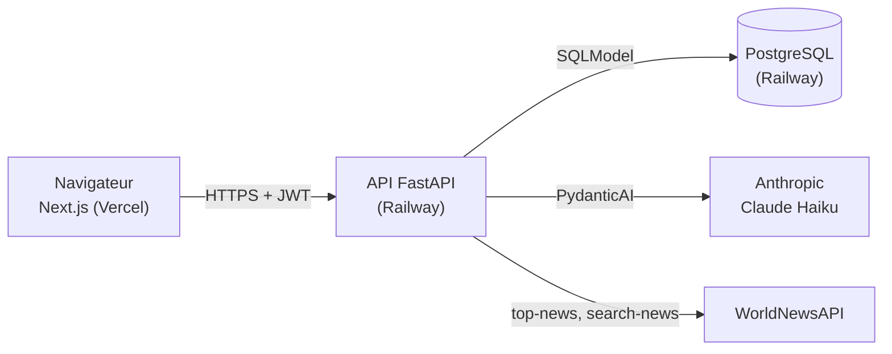
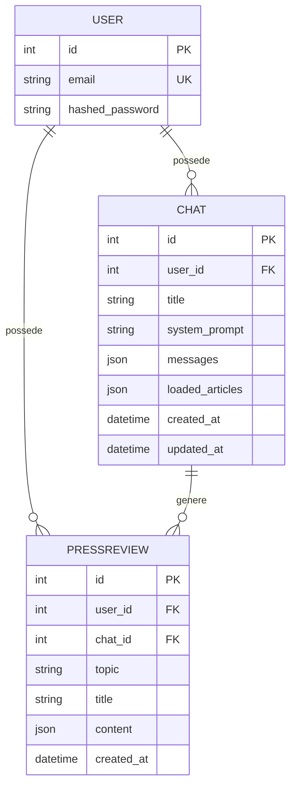
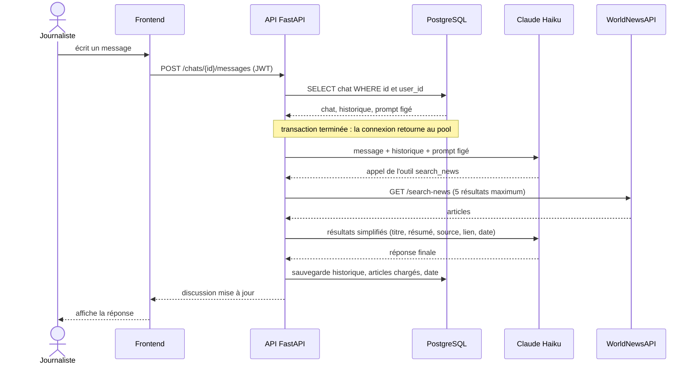

# Architecture

## Vue d'ensemble



- Le navigateur ne parle qu'à l'API : les clés Anthropic et WorldNewsAPI ne quittent jamais le backend.
- Le frontend est une application cliente : les données viennent de l'API, le token est dans le
  `localStorage`.
- Deux agents PydanticAI : un agent de **chat** (avec l'outil `search_news`) et un agent de **revue
  de presse** (sans outil, sortie structurée).

## Arborescence

### Backend (`backend/`)

```
backend/
├── Dockerfile            # image slim, contexte de build = backend/
├── pyproject.toml        # dépendances, config pytest (pythonpath = src)
├── src/
│   ├── main.py           # application FastAPI, CORS, routeurs, lifespan (init de la base)
│   ├── config.py         # variables d'environnement validées (pydantic-settings)
│   ├── database.py       # engine, session par requête, création des tables, compte de test
│   ├── models.py         # tables : User, Chat, PressReview
│   ├── schemas.py        # schémas des requêtes et réponses (séparés des tables)
│   ├── errors.py         # format d'erreur unique {"detail": "..."}
│   ├── tracing.py        # traçage MLflow optionnel (développement local)
│   ├── auth/
│   │   ├── security.py       # hachage bcrypt
│   │   ├── jwt.py            # création et vérification des tokens
│   │   └── dependencies.py   # get_current_user : 401 si token absent, invalide ou expiré
│   ├── routers/
│   │   ├── auth.py           # POST /login, GET /me
│   │   ├── chats.py          # liste, création, lecture, envoi de message
│   │   └── reviews.py        # génération et liste des revues
│   ├── services/
│   │   └── news_api.py       # client WorldNewsAPI : cache, débit limité, sorties simplifiées
│   └── agents/
│       ├── chat_agent.py     # prompt système, outil search_news, appel du modèle
│       ├── review_agent.py   # agent sans outil, sortie structurée
│       └── history.py        # (dé)sérialisation de l'historique, vue pour le front, transcription
└── tests/                # conftest (base isolée), auth, isolation des chats et des revues,
                          # agents (TestModel / FunctionModel), client WorldNewsAPI, erreurs
```

Hors de `backend/`, `scripts/benchmark_reviews.py` mesure le temps de génération des revues
(développement uniquement, absent de l'image Docker).

### Frontend (`frontend/`)

```
frontend/src/
├── app/
│   ├── layout.tsx            # police, métadonnées
│   ├── login/                # page de connexion
│   └── (app)/                # groupe de routes protégé (sans effet sur les URL)
│       ├── layout.tsx        # garde d'authentification + sidebar
│       ├── page.tsx          # accueil : nouvelle discussion
│       ├── chats/[id]/       # discussion
│       └── revues/           # liste des revues de presse
├── components/               # Sidebar, Tabs, MessageBubble, Composer, ReviewCard,
│                             # GenerateReviewButton, Markdown, ErrorNotice, gardes de route…
├── hooks/useStartChat.ts     # création d'une discussion puis navigation
└── lib/
    ├── api.ts                # appels à l'API, ApiError, messages d'erreur affichables
    ├── auth.ts               # lecture et écriture protégées du token
    ├── format.ts             # dates et heures
    └── pendingMessages.ts    # premier message transmis à la page de la discussion
```

## Modèle de données



| Colonne | Rôle |
|---|---|
| `Chat.system_prompt` | Prompt de base + actualités du jour, **figé à la création** de la discussion |
| `Chat.messages` | Historique PydanticAI complet (messages, appels d'outils, usage), tel que le modèle le reçoit |
| `Chat.loaded_articles` | `{url, titre}` des articles renvoyés par `search_news`, sans doublon |
| `PressReview.content` | Sortie structurée : `{title, summary, articles: [{title, summary, source, url}]}` |

Les dates sont stockées en UTC avec fuseau (`timestamp with time zone`) ; le titre « Discussion du
JJ/MM/AAAA » est calculé en heure de Paris.

## Routes de l'API

Toutes les routes, sauf `/` et `/login`, exigent `Authorization: Bearer <token>`.
La documentation interactive est servie sur `/docs`.

| Méthode | Route | Rôle | Erreurs possibles |
|---|---|---|---|
| POST | `/login` | `{email, password}` → `{access_token, token_type}` | 401, 422 |
| GET | `/me` | Utilisateur connecté | 401 |
| GET | `/chats` | Discussions de l'utilisateur, la plus récente d'abord | 401 |
| POST | `/chats` | Crée une discussion (prompt figé avec les actualités du jour) | 401 |
| GET | `/chats/{id}` | Discussion et ses messages | 401, 404 |
| POST | `/chats/{id}/messages` | `{content}` → discussion mise à jour avec la réponse | 401, 404, 422, 502 |
| POST | `/chats/{id}/reviews` | `{topic}` → revue de presse générée et sauvegardée | 400, 401, 404, 422, 502 |
| GET | `/reviews` | Revues de l'utilisateur, la plus récente d'abord | 401 |

## Déroulé d'un message avec recherche d'actualités



- Le modèle peut appeler `search_news` jusqu'à 3 fois par message (garde-fou sur le quota).
- Si le modèle échoue, l'API répond 502 et **rien n'est sauvegardé** : le message peut être renvoyé.
- Si WorldNewsAPI échoue, l'outil signale l'échec au modèle, qui répond sans les résultats et
  prévient le journaliste.

## Génération d'une revue de presse

`POST /chats/{id}/reviews` charge la discussion (404 si elle n'appartient pas à l'utilisateur),
refuse une discussion vide (400), transforme l'historique en transcription texte
(« Journaliste : … / Assistant : … ») puis appelle l'agent de revue, qui n'a aucun outil et
renvoie un objet validé par Pydantic. La revue est stockée dans `PressReview`.

## Authentification et isolation des données

- `POST /login` vérifie le mot de passe (bcrypt) et renvoie un JWT HS256 signé avec `JWT_SECRET`,
  valable `JWT_EXPIRE_MINUTES`. Un email inconnu et un mauvais mot de passe renvoient la même
  réponse, en temps comparable.
- `get_current_user` décode le token (algorithme imposé, claims `sub`, `iat`, `exp` exigés) et
  recharge l'utilisateur : un token valide d'un utilisateur supprimé donne 401.
- **Isolation** : toute lecture de discussion passe par `get_owned_chat`, dont la requête SQL
  filtre `id` **et** `user_id`. Le chat d'un autre utilisateur n'est jamais chargé et reçoit le même
  404 « Discussion introuvable » qu'un identifiant inexistant. La génération de revue réutilise
  cette fonction, et `/reviews` filtre sur `user_id`.
- Les schémas de réponse sont distincts des tables : `hashed_password` ne peut pas être renvoyé.

## Gestion des erreurs

Toute erreur de l'API a la forme `{"detail": "message lisible"}`.

| Code | Cause | Affichage côté frontend |
|---|---|---|
| 401 | Identifiants invalides, token absent, invalide ou expiré | Sur la connexion : « Email ou mot de passe incorrect. » ; ailleurs, déconnexion et « Ta session a expiré. Reconnecte-toi. » |
| 400 | Revue demandée sur une discussion sans message | Message de l'API affiché tel quel |
| 404 | Discussion inexistante ou d'un autre utilisateur | Message « Discussion introuvable » |
| 422 | Requête invalide (champ manquant, message vide ou trop long) | Message en français construit à partir des champs fautifs |
| 502 | Le modèle n'a pas répondu (clé, quota, panne, sortie invalide) | « L'assistant n'a pas pu répondre, réessaie. » ; le message reste affiché « Non envoyé » avec « Réessayer » |
| 500 | Erreur non gérée | « Une erreur est survenue côté serveur. » ; détail dans les logs seulement |
| 0 | API injoignable (éteinte, réseau coupé) | « Le service est momentanément indisponible. Réessaie dans quelques instants. » |

Le middleware d'erreurs est enregistré avant CORS : les réponses 500 portent aussi les headers
CORS, sinon le navigateur les masquerait derrière une erreur réseau.
